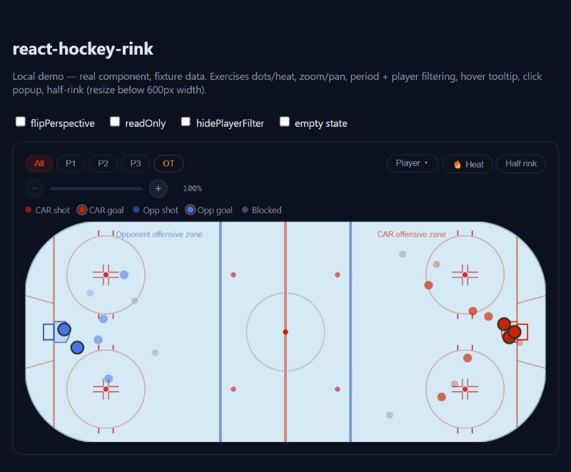

# react-hockey-rink

[](https://www.npmjs.com/package/react-hockey-rink)
[](./LICENSE)

An interactive, themeable ice rink shot chart for React. Dots or a kernel-density
heat map, zoom/pan, period and player filtering, hover tooltips, and click-through
shot detail — all rendered on a pixel-accurate NHL rink (200ft × 85ft, real goal
creases, faceoff circles, trapezoid, and restraint marks).

No CSS framework required — ships its own default-themed stylesheet you can
override with CSS custom properties.



## Install

```bash
npm install react-hockey-rink
```

## Usage

```jsx
import { HockeyRink } from 'react-hockey-rink';
import 'react-hockey-rink/styles.css';

const events = [
  {
    id: 'evt-1',
    team: 'primary',           // 'primary' | 'opponent'
    type: 'goal',               // 'goal' | 'shot-on-goal' | 'missed-shot' | 'blocked-shot'
    x: 84, y: 3,                 // NHL ice coords: x ±100 (end boards to end boards; goal lines at ±89), y ±42.5 (boards to boards)
    period: 1,
    timeInPeriod: '9:14',
    shooterId: 1,
    shooterName: 'A. Player',
    assist1Name: 'B. Setup',
    goalieName: 'C. Netminder',
    shotType: 'Wrist',
    shotSpeed: 94,
    zoneCode: 'O',
  },
  // ...
];

function ShotMap() {
  return (
    <HockeyRink
      events={events}
      teamAbbr="CAR"
      teamColor="#cc2200"
    />
  );
}
```

The primary team always attacks toward the right side of the rink (pass
`flipPerspective` to flip that — useful for a penalty-kill or defensive-zone
view of the same data).

## Props

| Prop               | Type                              | Default | Description |
|---------------------|-----------------------------------|---------|--------------|
| `events`            | `Event[]`                         | `[]`    | Shot events to render — see schema below. With none, the rink shows "Shot data appears here during and after games." |
| `teamAbbr`           | `string`                          | `'TEAM'`| Abbreviation shown in the legend, zone labels, heat-mode button, and popups for the primary team. |
| `teamColor`          | `string` (any CSS color)          | —       | Primary team's dot, legend-swatch, and zone-label color. Falls back to `var(--rink-team-primary)`. |
| `flipPerspective`    | `boolean`                         | `false` | Flips which side the primary team attacks — for a defensive/PK-style view. |
| `hidePlayerFilter`   | `boolean`                         | `false` | Hides the player-filter dropdown. It otherwise appears whenever primary-team events carry a `shooterId` (labelled with `shooterName`). |
| `readOnly`           | `boolean`                         | `false` | Hides the toolbar, zoom controls, heat controls, legend, tooltip, and popup, and turns off dot hover/click. Wheel zoom, drag-pan, and pinch still work. |
| `renderMedia`        | `(event) => ReactNode`            | —       | Your own media at the top of the popup — a replay, a different player, a still. Called for every event; return `null` to keep the default (a goal's `videoUrl` in an iframe). |

### Event schema

```ts
type Event = {
  id: string | number;
  team: 'primary' | 'opponent';
  type: 'goal' | 'shot-on-goal' | 'missed-shot' | 'blocked-shot';
  x: number;              // -100..100, ice coordinates
  y: number;               // -42.5..42.5
  period: number;           // 1-3 regulation, 4 = OT, 5+ = OT2, OT3, ... (leave shootout attempts out)
  timeInPeriod: string;      // e.g. '9:14'
  shooterId?: string | number;
  shooterName?: string;
  assist1Name?: string;
  assist2Name?: string;
  goalieName?: string;
  blockerName?: string;
  shotType?: string;
  shotSpeed?: number;
  zoneCode?: 'O' | 'D' | 'N';
  videoUrl?: string;         // goal only — embeddable clip URL (iframe src), shown at the top of the popup
                             // (or supply your own media with the renderMedia prop)
};
```

## Shot areas

The NHL breaks shots down into 17 areas (NHL EDGE's shot-location data:
"Low Slot", "L Circle", "Behind the Net", ...). It publishes per-area counts
and save/shooting percentages by name, but not the areas' shapes. This
library ships a classifier and a map for them.

```jsx
import { ShotAreaMap, shotArea, SHOT_AREAS } from 'react-hockey-rink';

shotArea(78, 2);   // 'Low Slot' -- (x, y) in play-by-play feet, attacking right
SHOT_AREAS;        // [{ name: 'Crease', danger: 'high' }, ...] all 17, NHL spellings; danger is the NHL's 'high' | 'mid' | 'long' grouping, or null

<ShotAreaMap
  areas={{
    'Low Slot': { fill: '#4ade80', label: '.850', title: 'Low Slot: 120 shots, .850' },
    'L Circle': { fill: '#fbbf24', label: '.901' },
  }}
  selected={area}
  onSelect={setArea}   // optional: makes the areas tappable
/>
```

- **Coordinates:** `shotArea(x, y)` takes the shot attacking right (the net at x = 89).
  Flip a shot at the left net (x → -x, y → -y) first.
- **L and R:** the shooter's left and right as they face the net, so the goalie's right and left.
  With y up, that's the top (+y) and bottom (-y) of the rink.
- **Fitted boundaries:** the boundaries (`AREA_BOUNDS`) are fitted to the NHL's own counts.
  They were checked on 30 goalies' 2025-26 regular seasons (~69,000 shots on goal).
  On average 2.7% of a goalie's shots land in a different area than the NHL counts there, at most 4.3%.
  It's the same on goalies held out of the fit as on the ones it was fitted to.
- **The map:** `ShotAreaMap` draws the attacking half plus a strip past the red line.
  `children` are drawn on top in the rink's SVG coordinates (`toSvg(x, y)` converts from feet), e.g. shot dots on the same rink.
  `outlines={false}` leaves out the outlines of areas with no fill.
  An area missing from `areas` is drawn as an empty outline.
  Labels are colored with `--rink-area-label` / `--rink-area-label-halo`, and outlines with `--rink-area-stroke` / `--rink-area-selected`.
  An area's `title` is its hover tooltip and, with `onSelect`, its accessible name; tappable areas also take Enter/Space.
  `ariaLabel` (default `'Shot areas'`) labels the whole SVG, and `className` is added to it.
- **Geometry exports:** `toSvg(x, y)` returns `{ px, py }` in the rink's 600×255 SVG viewBox (`W`, `H`, center `CX`, `CY`).
  `SHOT_AREA_POLYGONS` has each area's outline as `[[x, y], ...]` in feet and `SHOT_AREA_LABEL_AT` each label's `[x, y]`, both attacking right;
  `GOAL_LINE_X` (89) and `BLUE_LINE_X` (25) are the lines they're built on.
  `RinkMarkings` is the bare rink as an SVG `<g>`, for building your own chart on the same geometry.

## Theming

Every color, radius, and font in the default stylesheet is a CSS custom
property, prefixed `--rink-*` so it won't collide with anything else on the
page. Override any subset on `:root` (or a scoped ancestor) — no build step
required:

```css
:root {
  --rink-bg1: #ffffff;
  --rink-text: #111111;
  --rink-team-primary: #003087;
  --rink-radius-lg: 8px;
}
```

The rink markings and the opponent/blocked-shot dot colors are drawn inline in
the SVG and aren't tokens.

Full token list:

| Token | Default | Used for |
|-------|---------|----------|
| `--rink-bg1` | `#0c1120` | Popup / tooltip / dropdown background |
| `--rink-bg3` | `#172035` | Zoom button / dropdown hover background |
| `--rink-bg4` | `#1e2a42` | Zoom track background, zoom button hover |
| `--rink-red` | `#cc2200` | Zoom progress fill |
| `--rink-red-bright` | `#ff4422` | Active filter buttons, primary-team tooltip |
| `--rink-red-dim` | `rgba(204,34,0,0.15)` | Active filter button background |
| `--rink-red-border` | `rgba(204,34,0,0.35)` | Active filter button border |
| `--rink-blue-bright` | `#4d80f0` | Opponent-team tooltip/badge text |
| `--rink-blue-dim` | `rgba(34,68,170,0.15)` | Opponent badge background |
| `--rink-amber` | `#f0a030` | OT period buttons, shot-speed values |
| `--rink-text` | `#e4e8f0` | Primary text |
| `--rink-text-muted` | `#8a99aa` | Secondary text, legend |
| `--rink-text-dim` | `#808a94` | Tertiary text, labels |
| `--rink-border` | `rgba(255,255,255,0.06)` | Hairline dividers |
| `--rink-border-2` | `rgba(255,255,255,0.12)` | Button/panel borders |
| `--rink-radius-sm` | `6px` | SVG container corner radius |
| `--rink-radius-lg` | `14px` | Popup corner radius |
| `--rink-font-display` | `'Barlow Condensed', sans-serif` | Popup headings |
| `--rink-font-mono` | `'DM Mono', monospace` | Speed/zoom readouts |
| `--rink-team-primary` | `#ff4422` | Primary-team dot fill fallback |
| `--rink-area-stroke` | `rgba(255,255,255,0.9)` | `ShotAreaMap` area outlines (inline fallback; not set in the stylesheet) |
| `--rink-area-selected` | `#111` | `ShotAreaMap` selected-area outline (inline fallback) |
| `--rink-area-label` | `#111` | `ShotAreaMap` label text (inline fallback) |
| `--rink-area-label-halo` | `rgba(255,255,255,0.85)` | `ShotAreaMap` label halo (inline fallback) |

## Examples

**Heat map instead of dots by default** — not exposed as a prop. The view
mode is internal state and the only toggle lives in the toolbar, so a
`readOnly` rink always shows dots (open an issue/PR if you need a
`defaultViewMode` prop).

**Half rink on mobile** happens automatically when the browser window is
narrower than 600px (window width, not the container's); users can also
toggle it manually via the toolbar on wider windows.

**Read-only embed** (e.g. a small preview card, no interaction):

```jsx
<HockeyRink events={events} teamAbbr="CAR" readOnly />
```

## Development

```bash
npm install
npm run demo    # local demo app with fixture data, http://localhost:5183
npm run dev     # rebuild dist/ on change (for linking into an app)
npm test        # Vitest tests (jsdom)
npm run build   # library build (ESM + CJS) to dist/
npm run lint
```

## License

MIT
